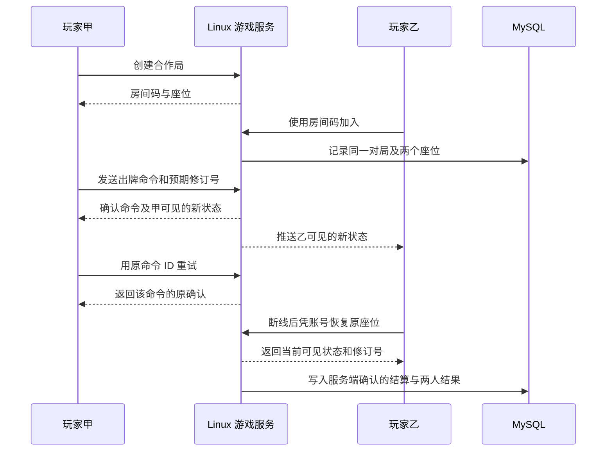

# 账号、MySQL 与云存档实施计划

2026-11-21 · 已按用户批准推进，实测与剩余验收见[内测记录](2026-11-21-account-cloud-save-delivery.md)。实施顺序为 MySQL → 登录与事件 → 管理员与统计 → 跨设备同步 → 自动保存优化 → 多人模式设计。多人模式本期交付设计，实际联机另立计划。

## 现状与方案

当前 Linux 通过 Nginx 提供公网 Web 试玩。桌面浏览器和手机浏览器使用各自站点的 IndexedDB 持久化 `user://`，Windows 原生开发使用本机 `user://`。现有 `SaveStore` 管理 `current_run`、`profile` 和 `settings`，已有临时文件校验、备份和恢复流程。`SnapshotCodec` 保存稳定局面、随机流、内容版本及校验和。`GameSession` 当前在自动保存开启时对接受的稳定命令尝试写盘。学年冻结奖励属于可保存状态，战斗中尚未完成的卡牌选择和效果队列要等结算完成才保存。[Web 部署与浏览器续玩证据](../G8整局体验验收记录.md) · [G5 存档边界](../G5存档恢复执行记录.md) · [会话保存实现](../../src/app/game_session.gd)

建议沿用 Linux 上的 Nginx。在同一个 HTTPS 站点下转发 `/api/v1` 到后端，只有后端连接 MySQL。首版技术选型建议 Python FastAPI、SQLAlchemy、Alembic 和 MySQL 8.4 LTS。Windows 本地开发连开发库，Linux 内测和公网分别使用独立数据库、凭据和会话。首批跨设备验收覆盖桌面与手机 Web，Windows 原生继续作为开发和存档回归入口。将来原生版接入同一账号和 API 时，再选定适合原生客户端的会话凭据保存方式。

```text
桌面与手机 Web → Nginx HTTPS → API 服务 → MySQL
     ↓                             ↑
  本地存档 ── 在稳定保存点排队同步 ──┘
```

## 1. MySQL 连接与建表

优先盘点是否已有可用 MySQL 实例，在独立开发和内测库完成连接与迁移。采用 InnoDB、`utf8mb4`、UTC 记录时间和参数化查询。运行账号仅具备所需读写权限，迁移账号单独管理。数据库仅监听回环或私网，凭据由部署注入，日志和构建产物不包含凭据。检查数据库连接的就绪路由仅供内部使用。

| 表 | 数据与约束 | 首次使用 |
|---|---|---|
| `users` | 固定 `user_id`、规范化邮箱唯一、昵称、密码哈希、角色、账号状态和注册时间 | 阶段 2 |
| `auth_sessions`、`auth_tokens` | 归属用户、过期时间、撤销或使用状态。会话凭据、验证邮箱与重置密码令牌只存哈希 | 阶段 2 |
| `matches` | 服务端 `match_id`、模式 `solo`、来源 `client_reported`、状态、游戏版本、内容标识、服务端接收时间和结局 | 阶段 2 |
| `match_players` | 对局、用户、座位、客户端 `run_id`、角色、难度和个人结果。`(match_id, seat_no)` 与单局内用户唯一。单人局用 `(user_id, client_run_id)` 幂等建立对局 | 阶段 2 |
| `game_events` | 事件 ID、类型、归属账号或游客访客 ID、可选 `match_id`、实际事件字段和服务端接收时间。事件 ID 去重，按日期和事件类型建立统计索引 | 阶段 2–3 |
| `admin_audit_log` | 操作者、操作、对象、结果、时间和请求 ID，记录管理权限变更及管理接口访问 | 阶段 3 |
| `save_slots`、`save_versions` | `(user_id, slot_key)` 唯一，指向当前已确认版本。版本记录云修订号、`run_id`、局内修订号、内容及 schema 版本、校验和、原始快照 | 阶段 4–5 |

**交付和验收**。交付配置样例、迁移、表与字段说明、备份恢复步骤。用应用账号验证连接和最小读写，用迁移账号创建全新库并再次执行迁移，核对表、唯一键和外键。将内测备份恢复到新库并核对关键行。测试故障时内部健康检查能区分 API 存活与 MySQL 未就绪。

## 2. 登录、单人对局与事件落库

- 登录建议采用邮箱和密码。提供注册、邮箱验证、登录、退出、忘记密码与账号删除入口。用 Argon2id 保存密码哈希，验证码或链接限时且一次有效。Web 使用同源 `HttpOnly`、`Secure`、`SameSite` 会话 Cookie，写请求检查来源并防 CSRF。登录、注册和重置接口限流，退出及重置时按策略撤销会话。公网开放注册前验证邮件送达。
- 主菜单提供「登录」和「继续以游客游玩」。已登录用户可在「我的对局」看角色、难度、到达学期和结局。服务器从会话识别用户，普通玩家的历史查询固定限定在自身账号。「我的对局」使用分页，局内无需打开账号面板。
- 从 `GameSession` 已接受结果提取实际开局、首战完成和终局。沿用 `RunSummary` 作为结算摘要。成功创建或明确重开后记开局，继续旧局和刷新时沿用同一 `run_id`。玩家明确放弃时可标记放弃，离线的进行中局保持原状态。开局、首战和终局各按 `(match_id, 事件类型)` 幂等，同局收到不同的终局摘要时保留先前记录并报告冲突。开局记录、参与者与对应事件在服务端同一事务落库，结算摘要和对应事件同理。离线时客户端使用绑定账号的持久化队列，恢复网络和原账号会话后按局顺序补传，重试复用原事件 ID。
- 首批事件固定为 `menu_opened`、`run_started`、`first_battle_completed`、`run_finished`。游客只记录启用可选统计时的主菜单到达，使用站点随机访客 ID。登录账号记录开局、每局首次完成战斗和终局，首战完成含胜负。账号对局记录和可选统计的用途分别在界面说明。只有实际到达主菜单或成功结算相应命令才产生事件。对局历史记录提交独立于自动保存设置。游客旧局的归属和导入由阶段 4 处理。
- 接口拟定 `POST /auth/register`、`POST /auth/login`、`POST /auth/logout`、`GET /me`、`GET /me/matches`、`POST /matches/start`、`POST /matches/{id}/finish` 和 `POST /events`，统一置于 `/api/v1`。来源由服务端按写入入口确定。单人数据标注为 `client_reported`，供个人历史与试玩分析使用。

**交付和验收**。用新账号走完注册、登录、开局、首战、终局和查询历史。重复提交、响应丢失后重试和恢复网络时，一次成功开局及结算各只产生一条对应记录。测试过期会话、越权读取、游客直玩和 API 不可用时的本地续玩。

## 3. 管理员权限与玩家统计

- 公网角色为普通玩家和管理员。普通注册固定得到玩家角色，首位管理员由部署人员通过服务端命令创建。按用户 §0.20.49 要求，管理员使用用户名或邮箱加密码登录，权限变更记录审计。§0.20.50 明确管理员即开发者：正式站与内测均向管理员开放测试房间、文本编辑器及既有测试工具，无独立开发者角色或团队资格开关。本机开发入口直接可用。公网管理功能首版提供聚合统计及按版本查看的对局漏斗。
- 游戏内对获权账号显示「管理统计」，服务端在每个 `/admin` 接口校验实际角色，接口返回聚合信息。生产统计只查生产库。控制台不展示密码哈希、会话凭据、玩家快照或原始逐牌操作。
- 玩家数按口径展示「已验证注册账号数」「区间内开局账号数」「区间内独立游客浏览器数」。游客在同一站点保留访客 ID 时刷新去重，跨浏览器和设备可能重复。账号及游客两列分别展示。登录对局漏斗以开局首次入库时间划定批次，按同一批 `match_id` 统计已完成首战和已结算局，支持按版本、日期、角色和难度筛选。离线补传以首次入库日计。存 UTC，日期看板默认显示北京时间。
- 建议明细统计保留 90 天。账号历史和当前云档随账号保留，玩家删除账号后清除个人记录，已删除数据随备份轮转到期。上线前确认保留期限和删除说明。

**交付和验收**。同一构建分别以游客、普通玩家和管理员进入。普通玩家手输管理地址或直接请求管理接口只能得到拒绝，销权对已登录会话立即生效。用包括刷新、重试、跨日结算和内测局的固定样本核对看板数字、去重口径与审计记录。

## 4. 跨设备同步与对局保留

| 数据 | 首版策略 |
|---|---|
| 当前冒险 | 每账号一个活动槽，上传最近一次已成功保存的完整稳定快照，沿用原编解码与兼容规则。服务器保留当前版和上一个有效版，冲突分支留在产生它的设备，直到玩家处理 |
| 个人进度 | 通过 `profile` 同步长期解锁和已见内容。同一 `run_id` 摘要一致时去重，解锁、已见 ID 依现有语义取并集。同 ID 摘要不一致时保留原数据并提示处理 |
| 已结束对局 | 服务端长期留 `RunSummary` 所需历史字段。活动槽替换后只在恢复版本内短期保留上一份完整对局快照 |
| 设备设置与开发数据 | 画面、音量、自动保存设置、文本覆盖、测试房间和 pilot 文件留在各设备 |

沿用 `SnapshotCodec` 的稳定状态检查、原始 JSON 与校验和。服务器限制大小、要求版本与元数据匹配，并校验结构和完整性。保持原始快照字节，读取端通过现有领域解码和兼容检查后才切换本地档。已支持的旧档按现有迁移路径在副本验证，未知版本、损坏档或无法迁移的内容保留原件。用实际快照验证 Windows 原生与 Web 的数值、随机流和校验行为一致。

首次登录时，游客文件与各账号的本地缓存分别存放。有本地进度时，可明确选择导入当前局与个人进度。导入前展示会一并带入的历史，导入记录标明来源并从新增开局漏斗排除。若云端已有另一局，展示两份档的角色、学期、保存时间和来源设备，由玩家选择。只有确认后才替换活动槽，另一份保留为恢复副本。退出、切换账号和会话过期都要暂停对应队列，其他账号无法看到或代传旧账号数据。

每个云槽使用独立、单调递增的云修订号。`GET /me/saves/{slot}` 返回当前版本，`PUT /me/saves/{slot}` 携带读取到的版本和幂等请求 ID。服务器事务内检查版本、写新快照并更新槽位。相同请求的重试返回原确认。两端基于同一版本推进时，后提交的一侧收到 `409` 和云档摘要，本地分支仍可读取。玩家明确选择后以最新读取的云版本提交，版本再变化时重新确认。局内 `revision` 会在新局重新计数，设备时间也可能有偏差。登录、从后台恢复和点「继续」时检查云版本，在安全的菜单或续玩入口处理分支选择。

**交付和验收**。通过公网同源内测地址，桌面 Web 打到战斗中稳定回合，手机 Web 登录恢复。对照牌组、手牌、回合、冻结奖励、随机流和后续同命令结果。覆盖游客旧档导入、损坏及未知版本、双设备离线分叉、两标签页竞争、重复上传、切换账号和数据库写失败。用合法旧 FY 档覆盖现有迁移路径。[快照格式](../../src/storage/snapshot_codec.gd) · [档案合并](../../src/storage/profile_merge.gd) · [旧 FY 存档处理](2026-11-20-relic-removal-design.md)

## 5. 自动保存优化

- 先测量 Windows 与浏览器上的现有写盘耗时、主线程帧时间、快照尺寸及稳定动作后的刷新恢复。首版保留现有本地自动保存触发语义，优先合并重复处理同一快照的写入和云请求。去重核对快照校验和及终局合并状态，避免同一局内修订下多步终局提交被跳过。
- 自动保存开启时，本地稳定检查点成功后排队上传。建议普通更新合并 5 秒，连续更新最多等待 15 秒发起上传。完成战斗、确认学年奖励、终局和「保存并返回」在本地成功后立即排队，网络请求异步处理。每个槽只并发一项写入，普通云快照可合并到最新稳定版，历史事件及待解决的备份独立保存。失败退避重试，网络恢复触发补传。「自动保存关闭」继续允许手动保存并触发同步。明确重开仍先完成本地替换再发布新局，终局沿用既有的档案合并约定。
- 区分「本机已保存」「待同步」「已同步」「同步冲突」「保存失败」。本地写入与浏览器持久化需要按真实结果显示。切到后台可尝试保存已稳定且符合自动保存设置的状态，刷新和关闭页面不作为唯一触发点。浏览器清站点数据会影响本地副本，未收到云端确认的进度只能从仍可用的本地副本恢复。
- 单独监测终局摘要提交、当前局写入和 `profile` 清理。失败后重试写盘或上传原结果。半条出牌、未确认卡牌选择和效果续算仍留在当前会话。冻结学年奖励原样保存，续玩不得重抽地图、奖励或牌序。

**交付和验收**。在固定动作序列下对比本地写盘次数、云请求数、快照大小和 P50/P95 写盘耗时。模拟断网、磁盘空间不足、浏览器存储拒绝、服务端超时和终局写入中断。成功本地保存后刷新可恢复相同状态，失败时还可恢复上一有效版本，结算记录和奖励各只提交一次。运行既有规则与 UI 回归，并用桌面浏览器、窄横屏及至少一台手机真机走保存、续玩和冲突提示。

## 6. 多人模式的设计交付

记录账号 ID、对局 ID、参与者和座位的归属约定。未来实时房间给每条命令绑定登录用户、座位、`match_id`、命令 ID 和预期修订号。Linux 规则服务校验回合和行动权限，服务端推进随机数和状态，发出各参与者可见的事件与视图。MySQL 用于保存阶段性恢复点和结果。客户端通过 WebSocket 接收状态，重连后按账号及座位恢复，并从最近确认版本继续。

设计稿列出当前 `GameSession.submit()` 的版本校验与事件输出可复用点，并标明当前 `BattleState` 只有一套玩家与牌区。另行决策每位玩家的手牌和资源、行动顺序、共享奖励、掉线处理及存档恢复点。本期完成接口与状态归属设计即可。联机房间、匹配、实时传输、对战规则、排名和观战列入后续多人需求。[命令入口](../../src/app/game_session.gd) · [当前战斗状态](../../src/battle/battle_state.gd)

以下时序用于审阅未来接口和数据归属。合作玩法及具体恢复点留待多人模式设计确认。



**交付和验收**。用这张时序图和纸面样例核对两名玩家可通过不同座位归属查到同一对局，以及未来服务端结果与当前客户端上报的来源字段如何并存。

## 游戏与平台参考

- 《杀戮尖塔 2》官方商店列出单人、最多四人在线合作、联机专属牌和队伍协同，并标注随时保存、Steam Cloud 和统计。借鉴同一游戏入口下的单人继续和组队入口，以及独立的对局参与者记录。具体回合同步、服务器存储与掉线规则按本项目设计。[官方 Steam 商店](https://store.steampowered.com/app/2868840/Slay_the_Spire_2/)
- 《Monster Train 2》官方商店列出随时保存、Steam Cloud 与每日挑战。借鉴普通冒险的续玩入口，以及按模式和版本归档对局以支持日后的挑战统计。[官方 Steam 商店](https://store.steampowered.com/app/2742830/Monster_Train_2/)
- Steam Cloud 文档说明按账号、跨设备同步，并建议按内容变化频率分开保存。沿用这一原则，将活动快照、长期进度和设备设置分别管理。本项目用自建账号和 Web API 实现。[Steamworks Cloud 文档](https://partner.steamgames.com/doc/features/cloud)

## 首版产品设置

| 决策 | 首版设置 |
|---|---|
| 登录与开放范围 | 游客可直接进入单人，邮箱密码用于注册。先上内测，邮件验证和重置跑通后开放注册 |
| 管理权限 | 管理员同时拥有聚合统计及开发工具权限，正式站和内测一致；本机开发入口直接可用 |
| 同步范围 | 每账号一个进行中云档，包含跨设备个人进度和已结算历史。先交付桌面与手机 Web |
| 对局保存策略 | 已结束对局留摘要，完整快照只用于继续和短期恢复，统计事件建议保留 90 天 |

批准后先将范围和验收编号登记到根实施计划与受影响的存储、接口和 UI 需求记录。按阶段提交内测证据，授权上线后再接入当前公网入口。证据包括迁移和恢复输出、隔离数据库样例、浏览器实机、故障用例、版本及快照校验结果。账号、管理员和云同步各有独立开关，回退时保留已写数据和可用本地保存路径。整版 G0–G8 的证据要求继续适用。[根实施计划](../../实施计划与验收基线.md)
