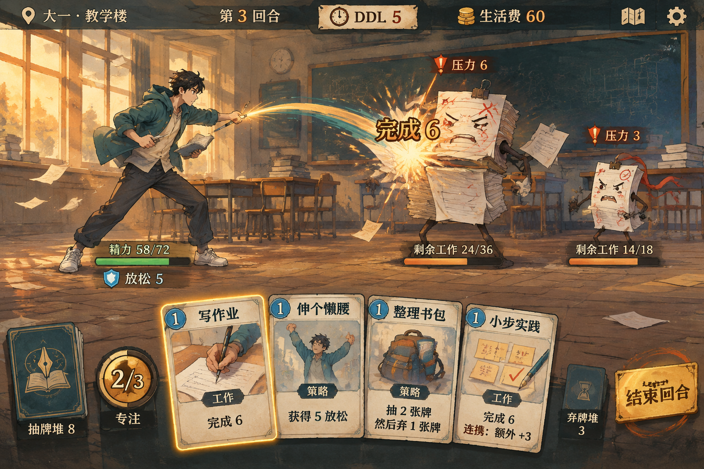

# 首版战斗概念图：已否决的历史探索

日期：2026-11-13｜状态：已生成，但随后被用户否决；不作为资源制作或布局参考。

否决原因：与当前程序的信息和机制结合不足，整体更像插画，未解决二代动态、地图和局外UI体系。最新方向以[ui-plan v2](../README.md)为准。本页保留当时生成记录，以下“示例表达/精修项”是历史观察，不表示继续采用该图。

原图：[battle-concept-v1.png](battle-concept-v1.png)，1536×1024。采用本机已配置服务，经 `local-imagegen` 与 bundled imagegen CLI 的 `images.generate` 生成，模型 `gpt-image-2.5-sunburst`，`quality=low`（配置中的草图质量），单张输出。没有上传项目图片或参考游戏图片；画面根据文字从零生成。

完整有效提示词：[battle-concept-v1.final.prompt.txt](battle-concept-v1.final.prompt.txt)。请求参数、提示词 SHA256、耗时与退出码见[生成记录](battle-concept-v1.generation.json)和[生成日志](battle-concept-v1.generation.log)。

示例表达：黄昏教室、独立学生角色、作业/试卷拟物敌怪、墨迹与纸页命中特效、意图/精力/工作量信息、四张不同机制插画的卡牌、笔尖/书页/时钟卡背、专注与结束回合控件。关联 UIR-002～007、011～016；授权范围见根计划 §0.19.1。

文件核验使用 `image-asset-check` 的 `audit_images.py`：PNG 可读取，实际 1536×1024，与请求尺寸一致，退出 0；完整 hash 等见[机器检查](battle-concept-v1.audit.json)。已实际查看原图，人物/敌怪独立呈现、卡背与卡面有区分，主要中文牌名、费用、效果、意图和资源可辨认。

后续精修项：人物持书/执笔的手部关系需要重新梳理；结束回合按钮标题上方有多余笔迹；类型主要靠文字，专用类型图标仍不完整；中央“完成 6”及光效偏大，应在实机中压低遮挡；四张牌示例不证明满手十张或小窗口可读性。数值、敌怪形态及动作时刻均为构图示意，未与真实会话绑定。

过程记录：第一次 CLI 参数检查拒绝文档所述 `--max-attempts`，当时未发出生成请求，见 [preflight 日志](battle-concept-v1.preflight.log)。第一条实际请求被服务以 HTTP 400“缺少参考图”拒绝，没有图片输出；已保留[原提示词](battle-concept-v1.attempt1.prompt.txt)、[失败请求记录](battle-concept-v1.attempt1.json)和[日志](battle-concept-v1.attempt1.log)。简化为独立文字描述后第二次实际请求成功，生成耗时约 55 秒。

此图是概念图，不是游戏实机截图，不能证明动画、命中、操作反馈或 G6/G7/G8 验收通过。原图没有进入游戏资产索引；正式 UI 的文字、数字、命中区域和特效需要分层实现与真实验证。
