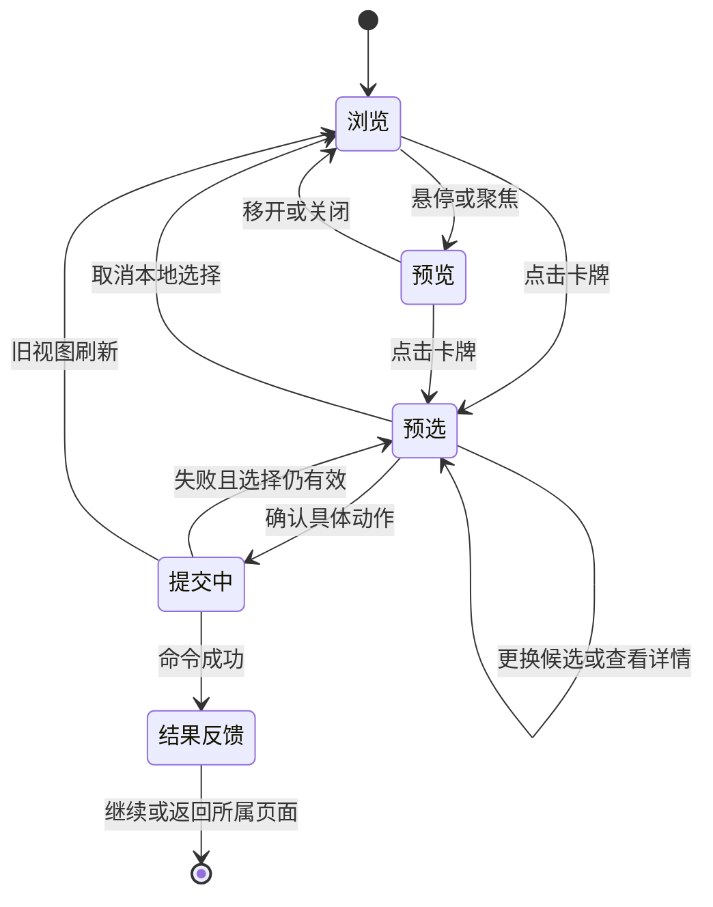

# UI 体验与布局改善方案：参考《杀戮尖塔2》

版本：v1.2｜日期：2026-11-04｜状态：用户已授权执行；A–D 及战斗遮挡/叠牌入口追加已实施，实际测试、渲染与剩余验收边界见[实施记录](../docs/UI体验改善实施记录_20261104.md)。

本文先按用户要求交付文字方案，现已依据用户执行指令及根计划 §0.12 实施。以下布局原则与验收要求继续有效；实际代码、测试和截图统一见实施记录，不把目标条款直接当作通过证据。沿用现有资源与规则，新增可选表现设置，不修改局存档 schema，也不标记 G0–G8 的任何阶段整体通过。

## 1. 改版目标与推荐方向

目标是让玩家进入页面后，先看见当前要操作的对象，再按需要查看说明，并始终知道下一步在哪里。卡牌、任务、商品、饰品和路线节点应成为主要交互对象；整页说明文字与大面积通用按钮退出视觉中心。

用户提出的核心需求采用为本轮推荐方向：**获取卡牌时，候选牌以完整卡牌对象居中悬浮展示；鼠标悬停或键盘聚焦后抬升放大，展开完整卡文与词条解释。默认收起牌外的长介绍，点击卡牌进行预选，底部确认领取。**同一套展示与查看方式延伸到商店、牌组、升级、事件目标选择和战斗待选。

| 可选改造方式 | 收益与代价 | 建议 |
|---|---|---|
| 对象为主、分层显示信息 | 页面围绕卡牌、路线、场景和商品组织；统一预览、选择、确认，需要重整公共组件及多个页面 | **推荐，作为本文方案** |
| 在当前长页面上压缩文字和图片 | 改动小，可缓解局部拥挤；页面之间的选择方式及滚动问题仍然存在 | 可用于短期修补 |
| 以大插画和动画为主，说明全面隐藏 | 氛围强，需要更多素材；玩家比较成本和规则的负担增加 | 留作资源充足后的表现补充 |

保留项目现有的校园题材、明亮水彩、米白纸张和深青线条。用空间层次、对象大小和交互反馈改善体验，现有卡图优先复用。当前组件尺寸、布局断点和渲染结果已在实施设计及记录中登记，最终人工审美与资源许可仍待签收。

## 2. 参考来源与观察边界

本轮核对了《Slay the Spire 2》官方 Steam 商店提供的 6 张截图，读取日期为 2026-11-04。原始来源地址、截图地址与 SHA256 见[参考来源登记](../artifacts/verification/ui-redesign-doc-20261104/reference-metadata.json)，可查看[截图联系表](../artifacts/verification/ui-redesign-doc-20261104/sts2-reference-contact-sheet.jpg)。截图反映公开展示的画面，不用于证明特定补丁的全部交互。

| 已实际看到的参考 | 可借鉴的信息组织 | 本项目转化 |
|---|---|---|
| 截图 0、1：战斗与底部手牌；截图 0 有一张突出显示的大卡 | 战场留给行动对象，手牌形成稳定操作区，当前关注对象突出 | 维持独立战场，修正手牌、目标提示、状态和角色资源的空间关系 |
| 截图 0、3、4、5：顶部资源和工具入口 | 局内资源与工具入口保持稳定 | 顶部常驻学年、精力、金钱、牌组、饰品及暂停入口 |
| 截图 2：角色立绘、角色信息和底部角色切换 | 一次突出一个角色，说明围绕当前角色展开 | 选角页显示当前角色大图与被动，起始牌组按需查看 |
| 截图 3、4、5：场景与选择项的构图 | 场景提供情境，选项集中排列，选项附关键后果 | 事件、休息和校园服务采用场景区与紧凑操作区 |

**本次官方静态截图没有覆盖奖励选卡页、路线地图和商店完整流程，也不能确认悬停延迟、键盘行为或确认次数。**本文的中央奖励卡牌、路线画布、货架布局和统一确认方式属于针对本项目的改善建议，其中中央悬浮卡牌明确来自用户需求，不写成官方已验证行为。

## 3. 改版前现状依据与主要问题

沿用本次前序检查的实际鼠标操作、页面截图与受控检查点。实际游玩覆盖 P01、普通难度、seed 42 的开局、首战、卡牌奖励、事件、商店与首次饰品入口；学年大奖励、方向、毕业去向等为受控检查点，不是完整通关。相关材料见[检查数据](../artifacts/verification/player-ui-audit-20261104/probe.json)和[操作日志](../artifacts/verification/player-ui-audit-20261104/desktop_actions.jsonl)。

| 问题 | 玩家感受与实际表现 | 改善方向 | 优先级 / 需求 |
|---|---|---|---|
| 卡文缺少实际效果 | 能力牌只见费用和消耗；章节缺常驻与生效时机；连携条件遗漏；动态值显示内部字典 | 先补齐统一语义，再将完整说明放入预览层 | P0 / FY-UX-001 |
| 图片与文字像资料列表 | 奖励页是插画、标题、全文和独立选择按钮；卡牌本体缺少统一的可交互形态 | 中央卡牌对象、悬停放大、点击预选 | P1 / FY-UX-002、003 |
| 学年奖励和事件过长 | 大奖励把整副牌的升级/移除目标排在资源奖励前；事件选项之间插入全部升级牌 | 先展示所有行动类别，再打开目标选择 | P1 / FY-UX-004、009 |
| 同类选择的结果不同 | 普通奖励先选再领，学年奖励点击即领取；移除目标可能直接提交 | 统一“查看→预选→确认→反馈” | P1 / FY-UX-003、004、010 |
| 关键状态在画面上缺席 | P03 施加的虚弱、乏力只能在详情中看到，普通任务卡与悬停摘要遗漏 | 任务旁常驻状态标记、层数与生效反馈 | P0 / FY-UX-006 |
| 角色信息缺少重点 | P01/P03 套用协同摘要；资源栏的“I 详情”没有对应资源目标 | 各角色使用专属资源区，每项都有明确解释入口 | P1 / FY-UX-006 |
| 地图像长表格 | 路线重复用文字描述连接，菜单和保存入口在页面底部；部分节点名字与进入内容不符 | 真实连接的路线画布，固定导航，诚实标注随机遭遇 | P1 / FY-UX-005、014 |
| 比较和取舍不够明确 | 升级差异藏在 tooltip；饰品满槽、删牌和重要方向缺少完整结果预览 | 操作前直接显示差异、支出和替换结果 | P1 / FY-UX-010、011、012 |
| 页面缺少规则解释与结果原因 | 帮助偏重按键；DDL 失败仍只写“本局结束”；保存提示比获得结果突出 | 核心规则卡、明确失败原因、结果优先反馈 | P1 / FY-UX-013、015 |
| 固定区域与内容互相遮挡 | 抬牌盖住操作提示，设置新局需要长距离滚动，少图处形成空白 | 分配固定职责区，独立内容滚动和自适应占位 | P2 / FY-UX-007、014 |

检查时 1280×800 的页面主体可视高度为 646，学年大奖励内容高 2086，资源奖励位于约 y=1947；地图内容高 2175，菜单位于约 y=2065。这些数据说明需要调整信息结构，不能只缩小字号。见[学年奖励截图](../artifacts/verification/player-ui-audit-20261104/controlled/grand-1280.png)、[当前地图截图](../artifacts/verification/player-ui-audit-20261104/controlled/map-current.png)与检查数据中的几何记录。

现状修正：选角已经展示角色被动，新局已经移除历史版本选择，地图当前使用“学年”。这三项作为现有能力保留，不重复列为缺陷。角色、任务与饰品缺图已有 FY-ART-002 独立工作；本文只要求布局能处理缺图，素材完成状态以后续资源记录为准。

## 4. 全局布局与信息规则

### 4.1 统一的页面职责区

| 区域 | 展示内容与行为 |
|---|---|
| 顶部常驻栏 | 当前角色、学年、精力、金钱；牌组、饰品、帮助、暂停。菜单和保存状态不随主体滚动消失 |
| 中央主体区 | 当前页面的主要对象：战场、卡牌候选、路线、商品或事件场景；每页只有一个明确的主要任务 |
| 对象详情层 | 完整卡文、关键词、关联对象、当前/升级比较；跟随悬停、键盘焦点或固定查看 |
| 底部操作区 | 当前选择、实际代价、确认或继续、返回/跳过；位置稳定，按钮写清动作对象 |
| 短反馈区 | 获得、购买、升级、替换、失败的结果；保存状态作为次级提示 |

战斗保留专属布局：专注靠近手牌，DDL 与任务进程可见，结束回合位于独立操作位。通用底栏不覆盖手牌与瞄准目标。局外页面的顶栏只显示相关资源，避免把无关战斗数值放到地图与商店。

### 4.2 哪些信息常显，哪些按需展开

| 信息层 | 必须包含 | 展示方式 |
|---|---|---|
| 第一层：辨认与代价 | 名称、插画、费用/价格、类型、稀有度/升级标记、可用状态；当前动作的支出、不可逆变化和关键风险 | 默认可见；颜色同时配合形状或文字 |
| 第二层：完整操作规则 | 全部基础效果、条件、触发、时点、次数、目标、消耗/保留、能力与章节、相关伙伴或场景 | 悬停/聚焦展示完整卡面，选中后可固定；重要抉择的结果摘要仍留在底栏 |
| 第三层：深入理解 | 关键词解释、规则时序、关联对象详情、历史记录、完整日志 | 词条小窗、详情抽屉和帮助面板 |

“隐藏介绍”指收起重复的长段文字。玩家确认之前，应能在当前选择状态看见支付什么、得到什么、失去什么；不得把价格、饰品替换目标、精力损失或方向后果仅放在鼠标悬停里。卡牌候选的完整效果可以按需展开，但查看入口必须明显。

### 4.3 统一卡牌状态与输入

| 状态/输入 | 预期表现 | 是否提交游戏命令 |
|---|---|---|
| 默认 | 居中排列的竖版卡牌；图、名称、费用和类型清晰；牌外不重复全文 | 否 |
| 悬停 / 键盘聚焦 | 单张抬升、适度放大，完整卡文展开；有关键词时在旁显示解释 | 否 |
| 点击 / 选择键 | 预选该牌，用边框、标记与底部名称共同确认；详细效果固定可查 | 否 |
| 更换选择 | 高亮和底部对象同步更新，其他候选继续可查看 | 否 |
| 固定详情 | 使用可见详情入口或现有固定键；指针可移入说明区阅读长内容 | 否 |
| 确认领取/购买/升级 | 提交一次相应公开命令；等待时锁住重复提交 | 是 |
| 取消本地预选 | 返回浏览状态，关闭局部面板，恢复原焦点 | 否 |
| 成功 | 短暂展示结果，卡牌向牌组入口收拢；立即更新数量 | 只呈现已成功结果 |
| 失败 | 保留可重试的选择，说明原因；旧视图则刷新并要求重新确认 | 不自动重发业务 |

局外鼠标预览建议沿用已有约 0.25 秒的延迟，减少经过时闪烁；键盘聚焦直接出现预览。具体时长留 G7 实测。鼠标移入预览区后保持显示，避免文字刚展开就消失。悬停目标与点击目标分离，卡牌抬升不得导致命中区域反复切换或穿透到背景按钮。

默认用阴影、空间层级和抬升营造“漂浮”的感觉；持续轻微动态为可选表现。减少动态模式使用静态高亮。预览不遮住确认键、关键代价和当前操作对象；空间不足时切换为固定详情区。

现有插画按原比例嵌入竖版牌框，保留主体，卡名、费用和效果由独立文字层绘制。升级复用插画，用升级标记和实际规则差异区分；缺图时采用有名称和类型的明确占位，卡牌仍能查看和选择。

以上状态图适用于提交前的局外选择。**战斗效果已经开始后的强制待选**沿用现有 `pending_choice` 约束，不能用 Esc 取消规则、保存半条效果或操作背景；Esc 只关闭其中的详情。页面文案和按钮必须明确区分“取消预选”与“必须完成的选择”。

## 5. 各页面的改善方案

### 5.1 普通战斗奖励：中央悬浮选卡（FY-UX-003）

初始画面保留弱化的场景或地图背景，上方简短写“选择一张卡牌”，中央完整摆放实际候选，通常为三张。已自动获得的金钱作为“已获得”结果显示，卡牌奖励标为“待选择”。候选数量以冻结 offer 为准。

卡牌默认显示紧凑辨认信息；悬停或聚焦展开完整卡面，外侧按需显示词条。点击预选后，底部出现“已选：扫清障碍”“领取这张卡”，旁边保留“跳过卡牌”。领取不再依赖卡牌下面一排重复的“选择某某”按钮。跳过进入底部“确认跳过”状态，取消可恢复，不额外叠套确认弹窗。

成功后显示“已加入牌组：卡名”，卡牌向牌组入口收拢。减少动态或动画关闭时直接呈现相同结果。有多项奖励时显示处理进度，只处理当前项；剩余项未完成前保持奖励流程，完成后按既有规则返回地图。

### 5.2 学年大奖励：先选类别，再选对象（FY-UX-004）

首屏同时显示所有互斥类别：“获得高阶卡牌”“升级或移除一张牌”“获得资源”，以及规则允许的放弃奖励。每类附一行收益，资源项显示本次真实金钱与实际回复量；不要求玩家滚动经过整副牌才能发现资源项。

选择卡牌类别，中央进入冻结候选的悬浮选卡；选择调整牌组，先切换升级/移除，再打开牌组选择器；资源类别显示获取前后资源。底部始终提示“本次只能选择一项”。在最终确认前，可以返回类别页重新比较，候选不重抽。确认按钮分别写“领取此卡”“升级此卡”“移除此卡”“领取资源”。

成功后只消费一次学年奖励；前三年按既有流程跨年，大四按既有流程进入毕业总结。确认前不预播跨年或把奖励计入余额。

### 5.3 地图：校园路线画布（FY-UX-005）

中央改为展示真实节点与连接线的路线画布，当前所在层与可进入节点成为视觉中心。已完成、当前、可达、不可达使用图形和标记区分，图例常驻或一键可见；路线数量、连接和可达性使用当前四学年视图，保持四张图的规则。

悬停/聚焦节点显示类型、公开风险、已知收益、费用与特殊后继。点击可达节点先显示简短详情，固定操作区提供“进入此节点”；仅有一个下一站时也由玩家主动进入。回到地图时定位当前进度，查看远处路线后可“回到当前位置”。滚动只移动路线画布。

普通随机遭遇应标为“普通战斗·随机校园任务”一类诚实预告。若要提前显示具体遭遇名，必须由服务层提供已经确定且可恢复的遭遇信息；UI 不按标题猜测敌人，不为修文案提前消耗随机流。不能继续出现“课后习题”进入“讲座考勤”而没有随机说明的情况。

### 5.4 战斗：看得见状态，找得到行动（FY-UX-006）

保留底部手牌和主体战场，给抬牌、目标提示、专注、任务状态和结束回合分别留位置。选牌时提示区明确写“选择一个任务”“对自身使用”或不可用原因；目标高亮、瞄准线和卡牌费用在同一选择状态内同步。提示不随手牌抬升被覆盖。

2026-11-04 用户截图追加：提示文字不得遮住手牌卡名，五张和十张手牌及悬停放大均须核对。牌组、记录、抽牌堆、弃牌堆及同类消耗堆统一使用带名称/公开数量的叠牌入口，悬停或键盘聚焦介绍用途，点击查看原有内容。抽牌堆保持仅公开数量。实施与验收见[追加设计](../docs/plans/2026-11-04-ui-experience-design.md)及实施记录。

任务附近常驻剩余工作量、屏障、阶段与公开意图；状态以图标/短名和层数显示，新增、减层、到期有短反馈。P03 的虚弱、乏力等不能依赖打开详情才能发现。状态较多时允许分行或明确的展开入口，所有有效状态仍可直接查看。

| 角色 | 优先展示的专属信息 |
|---|---|
| P01 林序 | 前牌类型、连携条件、被动机会是否可用、准备信息与相关限次 |
| P02 许知微 | 论文状态、进度/引用/修正/增幅，三章节顺序、生效时机与行动入口 |
| P03 沈见 | 任务负面组合、复合反应本回合机会及相关限次 |
| P04 唐屿 | 协同、首张合作触发机会、伙伴状态和正常/额外行动记录 |

上述信息以领域当前提供的只读字段为准，缺少语义时先补接口契约，UI 不自行推算触发机会。每个资源项有明确名称和详情目标，去掉没有对象的“I 详情”提示。

DDL 显示为“剩余完整轮末次数”，低余量时提供可见风险提示；详细说明沿用规则书的轮末时序。帮助中解释精力、专注、放松、阶段推进和胜负条件。已公开的合法目标、替代卡面与禁用原因按当前战斗视图显示，不承诺未经规则层支持的伤害或胜利预测。

### 5.5 选角与新局：聚焦当前角色（FY-UX-007）

用角色切换条选择四人，中央突出当前人物，旁边展示姓名、玩法摘要、被动名称及实际效果；起始资源简明显示，起始牌组通过按钮打开统一卡牌网格。现有四年唯一入口与被动文案保留。

难度和“开始冒险”在固定操作区；种子作为高级设置展开。更换角色不把开始按钮推到长页面底部。替换旧局时沿用当前明确确认、取消保旧和失败处理，结果预览显示准备开始的人物与难度。

### 5.6 商店：商品货架与固定购买摘要（FY-UX-008）

商品以卡牌和饰品对象排列，价格直接可见，售罄与买不起有不同标记和具体原因。悬停预览规则，点击预选商品，底部显示商品、价格、购买后余额及“购买”。精力恢复类商品显示实际可回复量与上限，避免满精力时只展示理论回复值。

“移除卡牌”成为独立服务入口，点击后打开牌组选择器。库存与删牌目标不堆在同一长页。饰品满槽先进入替换比较；买不起、次数用完或无合法目标时不能确认。成功后保留商店与原位置，更新余额和售罄状态，离店入口始终可见。

### 5.7 事件、休息与校园服务：先看完所有选项（FY-UX-009）

事件页用一侧场景/人物、另一侧叙事与紧凑选项；小窗口上下排列。所有选项先展示名称、费用、关键结果与可用性。选择“升级一张牌”等选项后，才打开统一目标选择器，返回时保留事件和阅读位置。

休息和校园服务同样先显示行动类别，按需进入选牌、恢复或方向调整。需要多个目标的选项用步骤提示表示完成情况，提交前可回看全部支出和收益。已被规则提交并进入效果内待选的流程继续遵守强制待选约束。

固定操作区只保留当前动作的确认、返回和规则允许的离开；无合法目标、费用不足或已用尽时解释原因。完成后显示实际结果，再沿既有流程回地图；反馈可跨页面保留短暂时间。

### 5.8 牌组、升级与移除：同一个选择器（FY-UX-010）

牌组按卡牌网格展示，可按名称、费用、类型、升级状态筛选或排序。只读牌组查看与有操作任务的选牌器共享卡牌显示，标题明确当前用途。相同定义的不同实例在升级/移除时必须能区分，提交使用实例 ID。

升级预选后，直接显示当前与升级后的卡面和差异，费用、数值、条件及新增效果均能对比；完整变化不能只放在 tooltip。移除预选后显示完整卡面、费用、移除后牌数及限制，并用“移除这张卡”确认。这个固定确认本身就是最后确认，不再叠一个重复弹窗。

没有合法目标时显示原因和返回入口；禁用目标可查看原因。返回后保留筛选、滚动位置与调用页状态。抽牌堆只显示公开组成，不泄露隐藏顺序；浏览不改变卡牌、候选或随机流。

### 5.9 饰品与满槽替换：看清保留和失去（FY-UX-011）

饰品候选居中排列，短名及核心触发摘要可见，悬停查看完整效果。当前三个装备槽在比较区同时可见。未满槽时预选后领取；满槽时选择要替换的旧饰品，显示“失去旧效果→获得新效果”，再确认。

重复折算、主动折算和跳过是不同动作，分别标明本次真实金钱结果。操作前显示获得饰品或金钱的明确结果，不能让“领取”暗中变成折算。未选替换目标时说明原因。确认后只展示服务层已经接受的结果。

### 5.10 学习方向与毕业去向：后果提前可见（FY-UX-012）

方向和去向改为并列选择卡：名称、当前加成/条件、后续影响、是否还有修改机会。预选后底部显示本局实际结果与确认按钮。毕业去向影响终局挑战，应在选择时说明关系与当前毕设条件，未知或未公开内容按规则允许的范围表述。

所有描述从现行设计与领域预览获取；文案不自行补造结局规则。暂停和返回菜单入口常驻；稳定 campaign 选择允许保存，返回后仍展示原候选。退出页面不等于放弃或自动选择。

### 5.11 结束、帮助与设置（FY-UX-013、014）

结束页首先说明结果与原因，例如“DDL 已到期，仍有未完成任务”“精力耗尽”“四学年已完成”；原因来自终局语义。然后显示进度、关键资源与本次记录，细项按需展开。“完成战斗”与“胜利战斗”使用对应事实和准确标签，避免败局给出误导统计。

帮助首页先解释胜负、阶段、专注、放松和 DDL，按键另列。术语可从卡牌与状态直接打开，保留已有快捷键。设置提供文字大小、减少动态、动画速度与音量，设置变更可见；存档诊断放在次级区域，出错时提供明确恢复入口。

### 5.12 操作反馈与转场（FY-UX-015）

反馈先说动作结果：“获得卡牌”“支付金钱并升级”“饰品已替换”“精力实际回复多少”。保存成功用次级标记，保存失败保留醒目提示与重试入口。业务已成功而保存失败时，必须写清“操作已生效，保存失败”，重试只重试保存。

新卡、资源变化和节点完成使用短反馈；场景切换后保留必要结果。按钮按下立即有视觉响应，确认等待期间只提交一次；表现结束不再触发业务。动画可加速、关闭或减少动态，最终卡牌、资源、状态和 RNG 相同。避免用长演出阻塞连续选牌与购物。

## 6. 可执行需求登记

以下需求均已有本轮实现；**自动化覆盖、实渲复核及仍待人工验收的子场景分别见实施记录**。关联契约为[界面层契约](../docs/界面层契约.md)，并继承根计划的 ARCH-001、CMD-001～003、RNG-001、SAVE-001/002、UI-001、UI-DOC-001。原有 FY/R3 台账的已实现部分继续有效。

| ID | 触发条件 → 必须行为 | 关联旧需求 / 实施位置 | 建议批次 |
|---|---|---|---|
| FY-UX-001 | 当任何位置查看卡牌时，必须提供完整、同源的效果、条件、动态量、能力、章节及关联对象说明；紧凑展示不得丢失详情入口 | R3-VIS-001/003/006；`ui_content_text.gd`、`ui_style.gd`、只读视图 | A |
| FY-UX-002 | 当卡牌被悬停、聚焦、预选或固定查看时，必须呈现一致的状态及完整信息；查看和取消不得提交业务 | R3-VIS-010、R3-ACT-002；统一卡牌/详情组件 | A/B |
| FY-UX-003 | 当进入普通奖励时，必须居中展示冻结候选；确认前可更改预选，成功后反馈实际入组结果 | VIS-005、ACT-001；普通奖励页 | B |
| FY-UX-004 | 当进入学年大奖励时，必须先展示全部互斥类别，并在类别内选择对象，确认一次后消费奖励 | FY-VIS-002/004；学年奖励页 | B |
| FY-UX-005 | 当查看路线时，必须显示真实连接、可达状态和固定导航；节点预告必须与固定/随机遭遇语义一致 | FY-VIS-001、VIS-004；地图与节点只读视图 | C |
| FY-UX-006 | 当战斗状态或选择改变时，必须更新任务状态、专属角色信息、DDL 与目标提示，关键区域不得被抬牌遮挡 | FY-VIS-005、R3-VIS-002/005～008、VIS-013；战斗布局/详情目标 | A/C |
| FY-UX-007 | 当切换新局角色时，必须聚焦该角色并保留固定开始入口，按需查看起手；旧局替换沿用确认语义 | FY-VIS-006、VIS-002；选角页 | D |
| FY-UX-008 | 当浏览和购买商品时，必须直接显示价格与可用状态，确认前显示购买后结果，成功后保留商店 | VIS-006；商店页 | C |
| FY-UX-009 | 当浏览事件/服务时，必须先展示行动选项，只有进入对应行动后才打开目标选择；返回保留原上下文 | VIS-007/008、FY-VIS-003；事件/休息/服务页 | C |
| FY-UX-010 | 当选择升级或移除目标时，必须显示目标实例、前后差异或移除结果，确认前允许取消 | VIS-006～008、R3-VIS-001；统一牌组选择器 | B |
| FY-UX-011 | 当获取满槽或重复饰品时，必须明确替换、折算与跳过各自结果，再提交一次确定动作 | FY-VIS-002、VIS-005；饰品与替换面板 | B |
| FY-UX-012 | 当选择方向或去向时，必须说明当前效果与已知后果，提供预选、确认和可用的保存/暂停入口 | FY-VIS-004；方向/去向页及领域预览 | C |
| FY-UX-013 | 当战斗/整局结束或打开帮助时，必须给出准确结果原因与关键规则，统计标签对应实际语义 | VIS-012、R3-ACT-002；摘要与帮助 | A/D |
| FY-UX-014 | 当页面缩放、打开/关闭覆盖层或切换输入时，必须保留可达操作、完整文字与合理焦点；必选待选仍锁定背景 | ACT-001/002、R3-ACT-002；页面壳、覆盖层与设置 | A～D |
| FY-UX-015 | 当动作成功、失败或保存失败时，必须分别反馈业务与持久化结果；动画只消费结果，关闭动画终态相同 | ACT-003、FY-AUD-001/002；页面壳与事件表现 | B～D |

当前实现以 `experience_page.gd`、`offer_card.gd`、`ui_page.gd`、`route_canvas.gd` 和战斗布局拆分职责，保留 `page_flow.gd` 的兼容基础。表中文件名表示职责边界，完整映射见实施记录。可复用组件的职责建议为：卡牌对象、详情/词条层、牌组选择器、结果比较区、固定操作栏、页面导航栏。实施时依据当前工程再确定文件拆分。

## 7. 验收场景与边界

以下是持续适用的验收要求；本轮定向自动化和实渲证据按 AC-01～15 逐项登记在实施记录中。完整人工路径和极端生产组合未统一签收，不将下面的要求表本身作为通过记录。

| 场景 | 可观察的验收结果 | 覆盖需求 |
|---|---|---|
| AC-01 卡文回归 | `R3-P01-10`、`R3-P02-10` 显示完整能力；`R3-P02-11` 显示章节常驻和下回合生效；`R3-P01-06` 显示连携抽牌条件；`R3-P03-05` 显示可读的动态规则，界面无内部字典；相关伙伴行为可查看 | 001、002 |
| AC-02 中央选卡 | 默认三个候选在 1280×800 和 960×600、标准字号下同时可见；鼠标和键盘都能展开全文、切换预选、取消与确认，确认键始终可达 | 002、003、014 |
| AC-03 查看不改局 | 悬停、固定、切换候选、打开牌组、返回类别、取消本地预选前后，领域状态/RNG/revision 相同；确认成功才发生对应业务变化 | 002～004、010、011 |
| AC-04 长页替代 | 学年大奖励首屏可见全部类别；12 张及更大牌组不把资源项或离开入口推到页尾；事件的其他选项不被目标牌组隔开 | 004、009、014 |
| AC-05 状态与战斗 | P03 实际施加虚弱 1、乏力 2 后，任务旁直接可见名称/标记与层数；详情含当前作用。四角色专属信息各有正确目标；抬牌不盖目标提示和结束回合 | 001、006、014 |
| AC-06 比较与实例 | 同名两张卡可准确选择其中一个实例；升级前后差异直接可读；移除显示真实费用与剩余牌数；确认前取消不扣费 | 010 |
| AC-07 饰品满槽 | 三槽已满、重复饰品、主动折算和跳过分别可预览正确结果；替换未选目标时有原因；成功只改变指定槽或金钱一次 | 011、015 |
| AC-08 商店/服务 | 资源不足、售罄、删牌次数用尽、无合法目标、满精力恢复均显示准确状态；购买成功保留位置与反馈，目标选择可返回 | 008、009、010 |
| AC-09 路线与预告 | 可达节点和连接与视图逐项一致；固定遭遇名字一致，随机遭遇明确标注；从远处查看回到当前节点、进入节点和暂停均可操作 | 005、014 |
| AC-10 方向与去向 | 确认前能看到实际加成及公开后果；稳定选择退出并继续后候选相同；不因查看预览重抽或提前消费奖励 | 012 |
| AC-11 失败与帮助 | DDL 到期和精力归零分别给出正确原因；阶段结束不误报整场胜利；帮助可找到精力、放松、专注、DDL 和核心胜负条件 | 006、013 |
| AC-12 连点与过期视图 | 连点、重复回车和动画中操作只提交一次；过期 revision 刷新后不自动重发；已领取项不能再次领取 | 003、004、008、015 |
| AC-13 焦点与强制待选 | 覆盖层打开后焦点留在层内，关闭后回到原对象；按 Esc 不触发背景动作；效果内必选无法取消规则或保存工作态 | 002、014 |
| AC-14 缩放与长文 | 在两种窗口、100%/125%/150% 文字大小以及长卡名、多状态、缺图场景下无文字裁切；大字号允许切换紧凑候选浏览和独立详情滚动，候选总数、当前位置与确认入口明确 | 007、014 |
| AC-15 保存与动画 | 业务成功但保存失败时，显示实际获得与保存失败，重试不重复收益；动画开/关、减少动态的终态/RNG 一致；结果反馈在自动回地图后仍能读到 | 015 |

补充边界：候选为空或详情缺失时显示可定位原因，确认不可用；单候选仍展示对象与确认；多候选按实际数量提供浏览入口；鼠标从卡牌移入长详情可继续阅读；禁用对象也能查看原因。焦点描边与选中标记同时存在，颜色不是唯一识别方法。

100% 字号下，核心类别和主要操作不依赖整页滚动；150% 字号下优先保证文字完整与操作可达，允许对象网格、路线画布或详情区独立滚动。不要用整体缩小 UI 来满足小窗口验收。

## 8. 建议执行顺序与交付切片

| 批次 | 内容 | 阶段交付与出口 |
|---|---|---|
| A 信息基础与公共交互 | 完整卡文、任务状态、角色资源语义、失败原因；卡牌状态/预览/焦点/固定操作区的公共规范 | 先完成相关只读语义和验收样例；形成一套可复用卡牌预览与选择基础 |
| B 卡牌与奖励闭环 | 普通奖励中央悬浮选卡→学年奖励分类→统一牌组选择/升级/移除→饰品比较→结果反馈 | 优先交付一个可实际操作的“获卡→查看→选择→确认→入组”切片，再覆盖其他奖励；通过 AC-01～07、12、13、15 的相关项 |
| C 局内页面结构 | 商店、事件、休息、校园服务、路线地图、方向/去向，以及战斗布局整合 | 所有关键类别和下一步可发现；页面路由、保存/继续、公开预览与旧视图处理按契约验证 |
| D 一致性与表现 | 选角、帮助、设置、结果页；文字大小、缺图降级、减少动态、短演出与音效细节 | 完成 AC-14 及跨页人工路径；对本次实际改动执行适当回归，补资源与可见证据 |

优先级是 P0 信息准确和状态可见→P1 选择与页面结构→P2 氛围和细节。公共交互可以先约定，第一条可玩切片优先体现用户要求的中央选卡。每批都应形成可审阅结果，避免所有页面改完后才第一次核对体验。

执行时继续按根计划处理 G0 规则/清单未决项，G6 资源核对、G7 设计与实现、G8 完整路径的出口保持独立。若某页只需复用现有资源，可先完成该页的相关核对；新图片需求另行登记，本文不触发付费生图。

## 9. 实施约束与后续需收敛项

1. 所有业务经 `GameSession`。预览、悬停、筛选、比较、拖动表现与本地预选只读；确认使用对应 offer/choice、实例 ID、run_id 和 revision，不为布局方便修改候选或随机流。
2. 普通奖励、稳定 campaign 选择和战斗效果内强制待选分别保留各自保存语义；共用显示组件不等于共用规则提交方式。
3. 卡文依据权威定义与实际引擎语义。发现设计/实现偏差时先登记和裁决，不通过文案承诺引擎尚未实现的能力。方向/去向结果、角色触发机会和终局原因可能需要补只读字段，属于实施前接口工作。
4. 工作区已有并行修改，执行前重读当前文件及资源记录，保留现有改动；本轮已按用户指令实施，不撤回此前授权的独立任务，工作区原有改动继续保留。
5. 当前已确定原生尺寸断点、卡牌/详情分区、字体缩放及短演出控制，详见实施设计与实际截图；最终图标/插画/字体的人工签收、手柄/触屏和完整无障碍仍待后续验证。紧凑战斗支持点击/数字键，标准扇形布局保留拖拽。

## 10. 本次交付与验证边界

用户已要求执行，A–D 的 UI、只读视图与可选表现设置已进入实际工程。完整代码映射及 AC-01～15 的证据与边界见[实施记录](../docs/UI体验改善实施记录_20261104.md)。导入、规则/UI 回归及两尺寸 56 张实渲均退出 0、引擎错误 0。未新增付费生图、未改玩法或局存档 schema、未操作实际玩家存档。

原文档期证据仍保留于[文档核查](../artifacts/verification/ui-redesign-doc-20261104/document-review.json)，只说明改版前的文档状态。当前代码验证以实施记录中的新日志/截图为准。G0 整版未决项、G6 人工审美/许可与 G8 自然四年完整路径、性能/打包继续独立收敛。

| 日期 | 变更 | 依据 |
|---|---|---|
| 2026-11-04 | 首次整理整体 UI 改善、中央悬浮选卡、页面布局与执行顺序 | 用户先交文档的要求；改版前检查；官方静态参考 |
| 2026-11-04 | 按 A–D 实施，更新需求状态、契约和实际验证入口 | 用户执行本计划的指令；根计划 §0.12；实施记录 |
